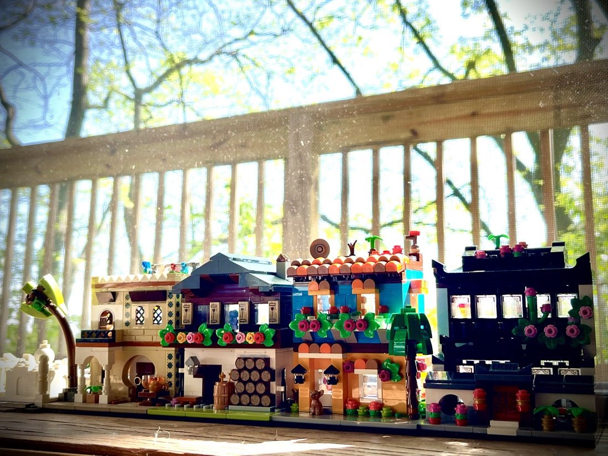
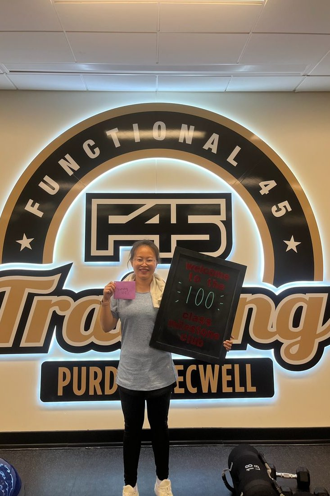

1. **Rainstorm Terminator:**  
Stopped a heavy rainstorm the moment I was born, and my name “Yuting” (graceful as a lotus) happens to sound like “the rain stops” in Chinese.

2. **Classics Lover:**  
Favorite book: [*Dream of the Red Chamber*](https://en.wikipedia.org/wiki/Dream_of_the_Red_Chamber). Nothing beats a classic in its original language.

3. **[F45](https://f45training.com/) Fighter:**  
Attended 150+ [F45 group fitness classes](https://www.purdue.edu/recwell/fitness-wellness/fitness/group-x/f45.php) at Purdue RecWell and counting.

4. **Lego Builder:**  
Lego is my go-to stress reliever and longtime companion.

---

